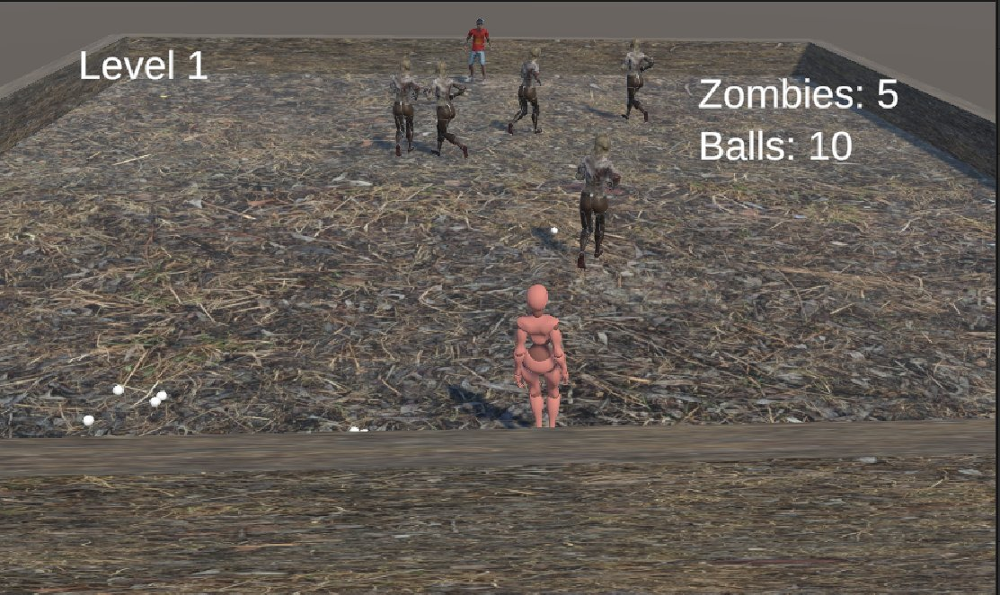
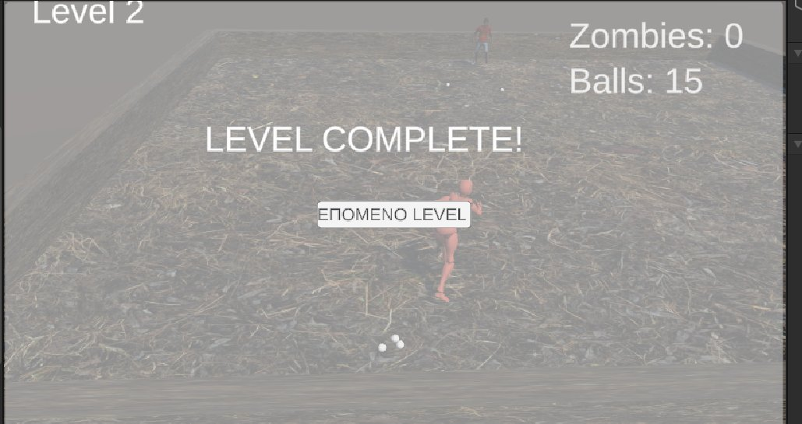
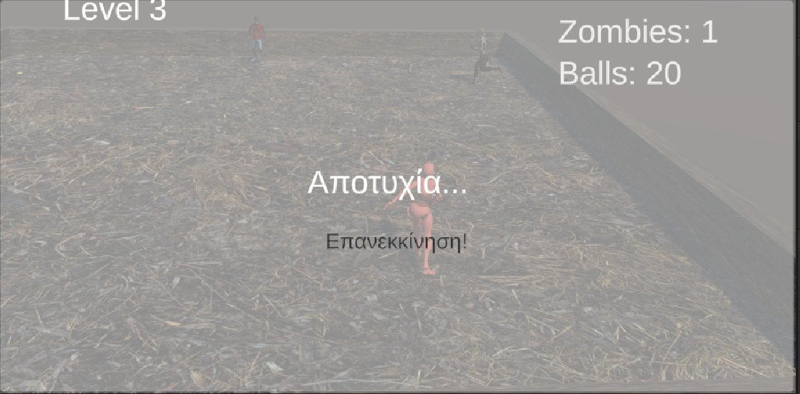

# Τα Μήλα ("The Apples") – Unity 3D Game

A 3D arena game made in **Unity (C#)** for the *Video Game Development* course, Department of Computer Engineering & Informatics, University of Patras. It is a digital take on the traditional Greek playground game "Μήλα" (a form of dodgeball), played against zombies.

Team of three. Each of us worked as programmer, game designer and artist, using Unity Version Control and making small changes to the project in turns.

## Gameplay
The player stands at one end of the arena and has to **eliminate all the zombies** moving in the central zone by throwing balls at them. The game has **3 levels** of increasing difficulty:

| Level | Zombie behaviour |
|-------|------------------|
| 1 – Basic Training | Simple targets, destroyed by a single hit |
| 2 – Evasive Action | Zombies can **dodge** incoming balls (random chance) |
| 3 – The Counter-Attack | Zombies can also **catch** the ball and **throw it back** at the player |

You win by clearing level 3. You lose if no balls are left (in your hands or in the arena) while zombies remain, and the game restarts from level 1. The in-game UI text is in Greek.

### Controls
| Input | Action |
|-------|--------|
| `W A S D` | Move |
| Left mouse button | Throw the ball (only while holding one) |
| Right mouse button | Catch (activates an invisible catch zone for a short time) |

A laser sight shows the throw direction and turns **red** when the aim assist locks on a zombie.

| Level complete | Game over |
|---|---|
|  |  |

## Implementation
All scripts are in [`Assets/Scripts`](Assets/Scripts). The scripts and scenes are heavily commented (in Greek).

| Script | Role |
|--------|------|
| `GameManager` | Singleton that runs the game: level list (`LevelSettings`), ball spawning, win/lose conditions and UI updates |
| `PlayerController` | Movement, throw, catch zone, aim assist (`OverlapSphere` + angle check) and the `LineRenderer` laser |
| `CompleteZombieAI` | Zombie reactions with a `NavMeshAgent` and `Animator`: dodge, catch, throw back. Probabilities are configurable in the Inspector |
| `RandomZombieRunner` | Random wandering of the zombies inside the central zone |
| `SimpleAISpawner` | Spawns the zombies of each level and reports their count to the `GameManager` |
| `BallController` | Ball logic: catch-zone detection, collisions and notifying the `GameManager` |
| `SimpleCameraFollow` | Camera that follows the player with a fixed offset |

Level rules (number of zombies and balls, dodge, catch) are plain data in the `GameManager` Inspector, so levels can be tuned without touching the code.

## Documentation
Course deliverables (in Greek):
- [Game Design Document](docs/Game_Design_Document.pdf): concept, characters, mechanics, levels, UI, implementation notes and screenshots
- [Implementation and user guide](docs/Implementation_and_User_Guide.pdf)

## Tech
Unity **2022.3.55f1**, C#, NavMesh (AI navigation), Animator, TextMeshPro, Unity UI. Characters and animations from [Mixamo](https://www.mixamo.com).

## Playable build
The playable build and the full Unity project are large, so they are not included in this repository. They are **available upon request**.

## Not included
This repository contains the **scripts, scenes and the ball prefab** only. The 3D characters, animations, audio and the Unity `ProjectSettings` and `Packages` folders are not included, so the project cannot be opened and run directly from this repository, and the scenes show missing references for those assets. Scene `Scene_3` is the full game and `SampleScene` is an early prototype.

## Known limitations
- A ball thrown back by a zombie is detected when it hits the player, but it does not yet reduce a life (the hook in `GameManager.PlayerHit` is empty).
- No automated tests. The focus was gameplay logic, not polish.

## Team
Group project (team of three).
